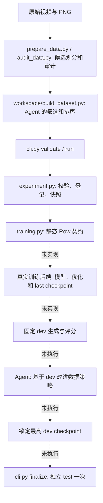

# pipeline-agent 首次真实实验：未完成的 kickoff 记录

截至本次记录，**真实端到端闭环未完成**：CPU 检查和模拟流程通过，准备了候选数据及部分预算代码；真实后端、baseline、数据策略改进、checkpoint 和最终 test 均未完成。没有真实指标，因此无法判断是否优于 baseline。模拟分数是固定占位值，不是实验结果。

## 流程与实际状态



实线 CPU 模拟链见 [日志](cpu.log) 和 [模拟状态](simulation/state.json)：模拟的两个 trial、finalize 无模型训练，checkpoint 为 null。原始测试及新增预算测试见 [pytest_final.log](pytest_final.log)。真实调用中 [training.py](../../training.py) 仍明确抛出 `REAL_BACKEND_NOT_IMPLEMENTED` / `REAL_TEST_NOT_IMPLEMENTED`。Agent CLI 的真实认证、启动和搜索没有验证。

## 本次相对于开始版本的变化

开始时间 2026-10-29 16:35:22 UTC，HEAD `b649a73ae8ed0628921af75ebe1fce83aa011082`，当时工作树干净。未提交或推送，未修改旧 pipeline 或既有产物。

实施阶段：[campaign.py](../../campaign.py) 新增带文件锁的总账登记、训练机会和截止时间/预留检查，以及限制 CUDA_VISIBLE_DEVICES、到期终止子进程组的辅助函数；[experiment.py](../../experiment.py) 在真实 trial 校验后登记并更新状态；[task.py](../../task.py) 要求真实配置指定现有 campaign 和预估时间；[example.yaml](../../configs/example.yaml) 添加配置说明；[tests](../../tests/test_campaign.py) 和 [原有流程测试](../../tests/test_flow.py) 覆盖基本预算、超时和失败语义。登记失败不会计数，登记后失败计数。测试使用临时账本，不消耗本次账本额度。

这些保护**尚不构成完整 GPU 执行验收**：真实训练和 test 尚无子进程调用可接入 `campaign.run_process`，设备占用与调度器分配未自动验证，其他账本也可由同权限调用者指定；超时测试只验证简单子进程，未验证 torchrun 子进程树。不得据此启动真实训练。账本 [campaign.json](campaign.json) 的 GPU 分配为空，候选设备仅是检查时空闲的物理 GPU 0–3。

搜索阶段：无真实 baseline 反馈，未修改 builder 策略、未进行任何改进轮次。候选数据的随机划分是宿主准备工作，不是通过 dev 验证的搜索策略。

## 数据与实验设置

[候选设计](experiment_design.md) 和 [数据审计](data_audit.json) 记录来源、种子、每条路径与哈希、预处理、完整解码帧数和查重。候选 train/dev/test 数量为 160/50/50；原视频字节和规范化端点像素无重复，生成参数 JSON 无跨 split 完全重复，260 项帧数与完整解码一致。历史曝光未知，且尚需检查重编码等价视频及 wrapper 语义，因此**尚未冻结**，不能作为正式无泄漏结论。拟采用的固定超参、种子和评分规则见候选设计和 [任务契约](../../tasks/reactdata.yaml)。尚无正式解析配置或冻结时间。

## 真实训练与评测结果

| trial ID | 策略 | 状态 | dev 指标 | 相对 baseline | 耗时 | 产物 |
|---|---|---|---|---|---|---|
| 无 | baseline 随机子集 | 未启动 | 未完成 | 未完成 | — | 无 checkpoint |
| 无 | 数据策略改进 | 未启动 | 未完成 | 未完成 | — | 无 |

真实训练尝试总数为 **0**，包括诊断和失败均为 0。没有有效候选，未锁定 checkpoint；最终 test 未运行，结果未完成。无最终选择依据可应用，不能报告 baseline 差值或显著性。

## 资源和预算

截止时间固定为 2026-10-30 00:35:22 UTC；总上限 8 小时，预留 5400 秒供最终 test 和报告。初检机器为 8 张 A40：0–3 空闲，4–7 有其他用户进程；本次未使用 GPU、未启动训练或评测 GPU 进程。训练机会消耗 0/7，剩余 7；模拟 trial 和测试夹具不计真实训练机会。实际结束时间和本次已用墙钟见 [campaign.json](campaign.json)。本次已完成工作满足 4 GPU、7 次与 8 小时限制；未来工作必须继续沿用该绝对截止时间和账本，不能重置。

## 复现、环境及接手

使用 Python `/homes/55/junlin/miniconda3/envs/internvlu/bin/python`；torch 2.6.0+cu124、CUDA runtime 12.4、驱动 530.30.02、OpenCV 4.13.0、transformers 4.52.3。Codex CLI 0.165.0 存在，认证状态未验证。权重 snapshot `f012d760e69712bb47f7d3d09a24280f346cee01`、外部模型库与 wrapper/cvlib 路径存在，加载及兼容性未验证；外部模型库 Git HEAD `b8e5f356ef6a72ac8388271caa49962c9aec1994`。不要把路径存在当成可训练的证明。

实际执行过的主要命令（工作目录 `pipeline-agent/`）：

```sh
/homes/55/junlin/miniconda3/envs/internvlu/bin/python -m pytest tests -q
/homes/55/junlin/miniconda3/envs/internvlu/bin/python runs/kickoff_20261029T163522Z/prepare_data.py
/homes/55/junlin/miniconda3/envs/internvlu/bin/python runs/kickoff_20261029T163522Z/audit_data.py
```

模拟的完整命令顺序为 README 阶段 1 的 `make_demo.py`、`cli.py init/task`、builder、`validate`、两次 `run`、`status` 和 `finalize`，使用本目录下 `simulation/`；具体结果见 [cpu.log](cpu.log)。脚本为一次性创建文件，重复执行前应使用新输出目录，不能覆盖此产物。

接手优先顺序：完成候选 split 的内容和文本审计并冻结正式配置；实现独立静态 Row 的真实训练、last checkpoint 保存和重载、固定 dev/test 生成与原规则 scorer；确保所有 GPU 子进程经共享账本及 watchdog 管理，并验证包含 torchrun 后代的超时；再按剩余截止时间执行 baseline、dev 驱动的改进与唯一 final test。还需验证 scorer 的 GT 和复制 F0 对照、训练步骤/批量/顺序/种子、checkpoint 哈希、日志和显存。如果截止或预留时间不足，应停止且继续如实报告，而不是重置预算。没有真实 checkpoint 或真实预测日志可链接。
